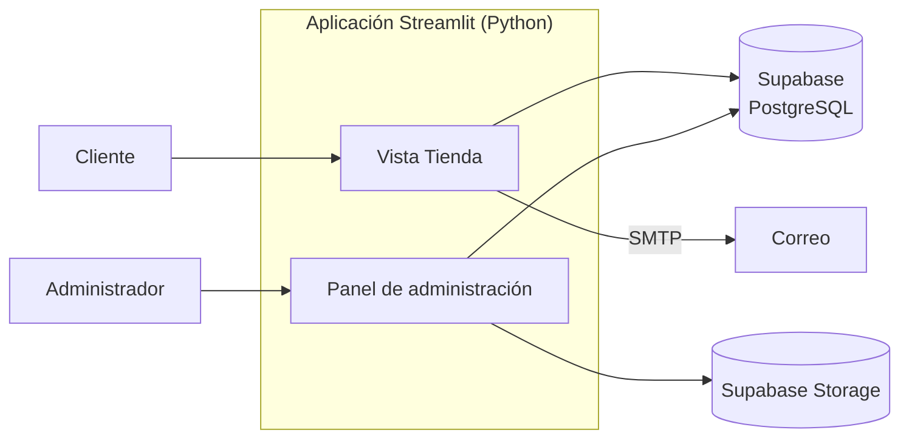

# Proyecto Integrador Transversal - Scene One Club

### Tecnologías Utilizadas

---
### Equipo 
* Sebastián Videla
* Francisca Sánchez
* Dilan Carmona
---
### Contexto Estudiantil
* **Asignatura:** Integrador Transversal
*  **Docente:** Carolina Fredes
* **Institucion:** Universidad Catolica del Norte
* **Año:** 2026
---

### Descripción del Proyecto
Repositorio oficial del sistema web desarrollado para **Scene One Club**. 
Esta aplicación busca centralizar y modernizar los procesos, integrando la **gestión** con un módulo operativo de **Punto de Venta (POS) e Inventario**. Permite a los administradores controlar el stock de indumentaria, registrar ventas en tiempo real y manejar la base de datos de manera eficiente.

---

### Contenido
- [El problema y la solución](#el-problema-y-la-solución)
- [Funcionalidades](#funcionalidades)
- [Arquitectura](#arquitectura)
- [Tecnologías](#tecnologías)
- [Estructura del repositorio](#estructura-del-repositorio)
- [Documentación](#documentación)
- [Estado y alcance](#estado-y-alcance)

## El problema y la solución

La tienda llevaba el inventario, las ventas y los clientes en Excel. Eso hacía difícil saber cuánto stock real quedaba, cuánto dinero
se había recaudado en cada lanzamiento y qué clientes compraban más. Tampoco había un lugar donde los clientes pudieran apartar prendas.

El sistema ofrece:

- Una **tienda de reservas**: el cliente elige prendas, talla y cantidad, y reserva. No hay pago online; la entrega y el pago se coordinan con la tienda.
- Un **panel de administración** para gestionar reservas, vender en tienda, mantener el inventario, conocer a los clientes y controlar las finanzas por tandas de venta.

## Funcionalidades

### Para el cliente

- Catálogo con las prendas agrupadas por nombre, selector de **talla** y **cantidad**, y filtro por categoría. Se actualiza solo.
- **Carrito de reserva** con foto de cada prenda, cantidades editables y el total en grande.
- **Códigos de descuento** con porcentaje, fecha de término y cupos.
- Reserva con nombre y correo; recibe su **boleta de reserva por correo** y puede descargarla.

### Para el administrador

| Módulo | Qué permite |
|---|---|
| **Reservas** | Revisar reservas, registrar pagos (efectivo o transferencia con captura), confirmar la venta o cancelar devolviendo el stock. |
| **Punto de venta** | Vender varias prendas a la vez, cobrar en efectivo o transferencia y generar el comprobante. |
| **Inventario** | Editar el stock como en una planilla, agregar prendas y tallas, administrar fotos, categorías y tallas. |
| **Clientes** | Ficha con compras acumuladas, comprobantes, y ranking de quiénes compran más. |
| **Finanzas** | Indicadores por tanda, gráfico por día, **cierre de tanda con historial** y **corrección de totales** con registro. |
| **Diseño** | Cambiar colores, tipografía, textos, logo y banner, y administrar los códigos de descuento, sin tocar el código. |

## Arquitectura

---
### Tecnologías

| Capa | Tecnología |
|---|---|
| Interfaz y lógica | Python 3.12 · Streamlit 
| Base de datos y archivos | Supabase 
| Análisis de datos | Data Studio |
| Control de versiones | Git y GitHub |

---

### Estructura del Repositorio
* `app/`: Contiene el código fuente visual de la plataforma (Frontend) y archivos de configuración de diseño persistente.
* `database/`: Scripts de conexión y lógica de integración con Supabase.
* `docs/`: Documentación técnica, diagramas BPMN, informes académicos y levantamiento de requerimientos.
* `assets/`: Recursos estáticos (logotipos, imágenes, mockups de Figma).

---

## Documentación

| Documento | Contenido |
|---|---|
| 01 · Requisitos | Alcance, actores, requisitos funcionales y no funcionales, reglas de negocio |
| 02 · Arquitectura y diagramas | Arquitectura, casos de uso, flujos y estados |
| 03 · Modelo de datos | Diagrama entidad-relación y diccionario de tablas |
| 04 · Manual de usuario| Guía paso a paso para clientes y administradores |
| 05 · Instalación y despliegue| Puesta en marcha, configuración y problemas frecuentes |
| 06 · Plan de pruebas | Casos de prueba de aceptación |
| 07 · Limitaciones y hoja de ruta | Lo que falta y las mejoras propuestas |
| Registro de cambios | Evolución del proyecto |

---
### Estado y alcance

El sistema cubre el ciclo completo de reserva, venta, inventario, clientes y finanzas. Quedan **fuera del alcance** actual el pago
online, la boleta electrónica del SII. 

