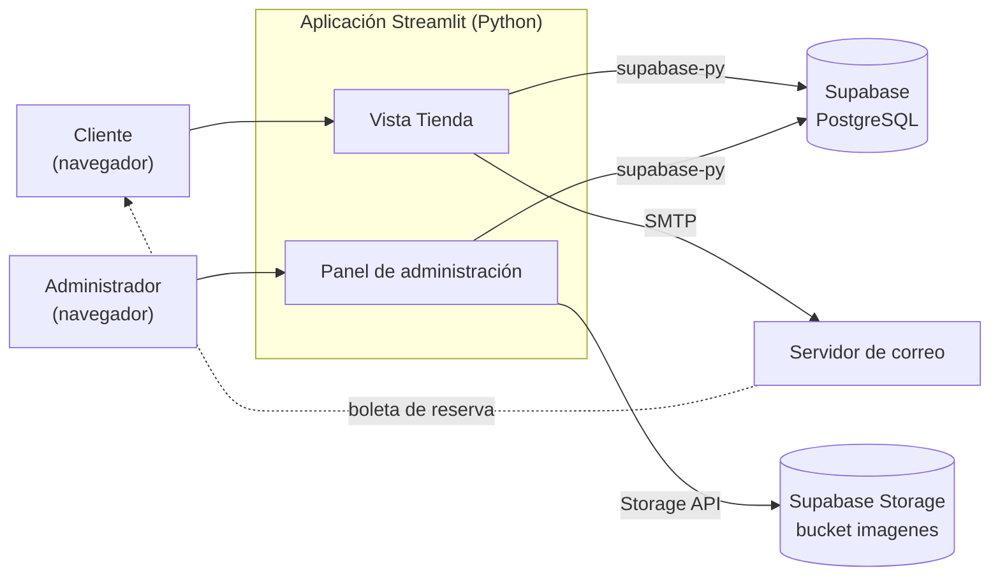
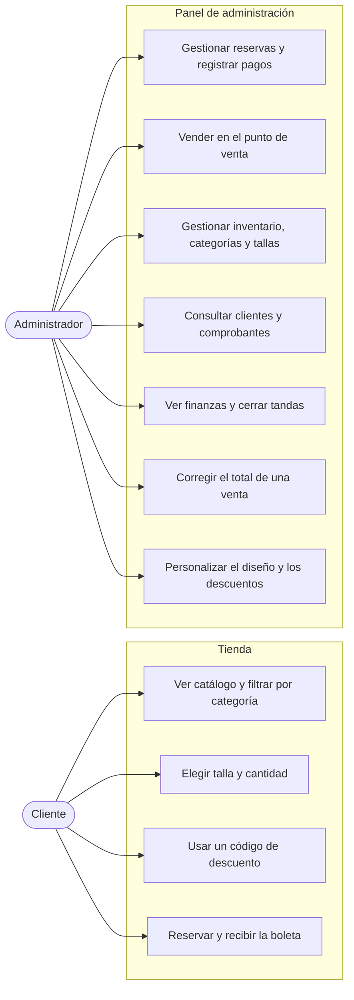

# 2. Arquitectura y diagramas

Los diagramas están escritos en [Mermaid](https://mermaid.js.org/), así que GitHub los muestra dibujados directamente.

## 2.1 Arquitectura general

La aplicación es un único programa en Python (Streamlit) que atiende a clientes y administradores. Guarda los datos en
Supabase (PostgreSQL y almacenamiento de archivos) y envía la boleta de reserva por correo (SMTP).

## 2.2 Casos de uso

## 2.3 Decisiones técnicas

| Decisión | Motivo |
|---|---|
| **Streamlit** para toda la interfaz | Permite construir una aplicación web completa solo con Python y a buen ritmo, ideal para un proyecto académico con alcance acotado. |
| **Supabase** (PostgreSQL + Storage) | Base de datos relacional gestionada, con almacenamiento de archivos y un plan gratuito suficiente para el proyecto. |
| **Clave `service_role` solo en el servidor** | La aplicación se ejecuta en el servidor, así que la clave nunca llega al navegador. Debe guardarse como secreto. |
| **`jsonb` para prendas y pagos** | Cada compra guarda su propia copia de las prendas y precios del momento; así los comprobantes no cambian si después cambia el catálogo. |
| **Tabla `ventas` por prenda, separada de `compras`** | Finanzas suma por prenda y por día sin recorrer el JSON de cada compra. |
| **Catálogo con refresco periódico** | Los cambios del inventario se ven en la tienda sin que el cliente recargue la página. |
| **Diseño guardado en base de datos** | El administrador cambia colores, textos y logo sin tocar el código ni volver a desplegar. |
