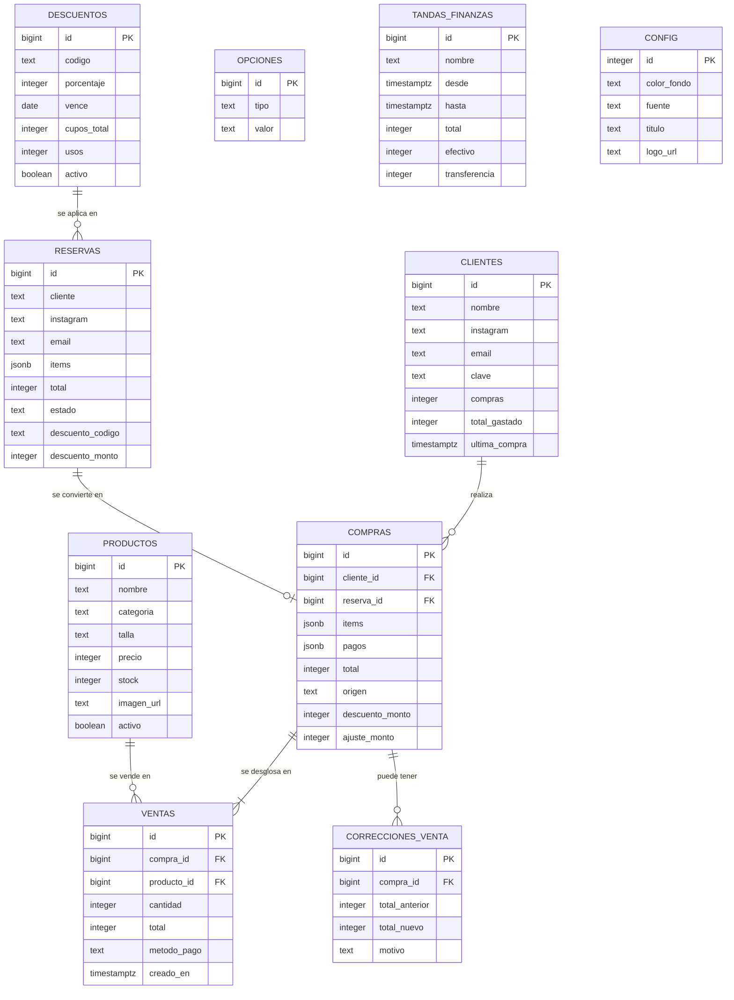

# 3. Modelo de datos

Base de datos PostgreSQL alojada en Supabase. El script completo está en database/schema.sql

## 3.1 Diagrama entidad-relación

Las relaciones son **lógicas**: las tablas se conectan por el id de la otra tabla, pero no se declararon llaves foráneas
(ver [limitaciones](07-limitaciones-y-roadmap.md)).

## 3.2 Diccionario de tablas

| Tabla | Para qué sirve |
|---|---|
| `productos` | Catálogo. Cada fila es **una prenda en una talla** (por ejemplo, "Polera Nightfall" talla M). La tienda agrupa las filas con el mismo nombre. |
| `opciones` | Listas de categorías y tallas que aparecen en los menús desplegables del inventario. |
| `clientes` | Un registro por cliente, con número de compras y total gastado acumulados. |
| `reservas` | Pedidos hechos desde la tienda. Estado: `pendiente`, `vendida` o `cancelada`. |
| `compras` | Venta completa y cerrada: prendas, pagos (con capturas), cliente, descuento y ajustes. Es la base del comprobante. |
| `ventas` | Una fila por prenda vendida. Es lo que lee el módulo de Finanzas. |
| `descuentos` | Códigos de descuento con porcentaje, fecha de término, cupos y usos. |
| `tandas_finanzas` | Historial de cierres: período, totales, efectivo y transferencia. |
| `correcciones_venta` | Registro de cada corrección de total: valor anterior, valor nuevo y motivo. |
| `config` | Diseño de la aplicación (una sola fila, `id = 1`). |

